<p align="center">
  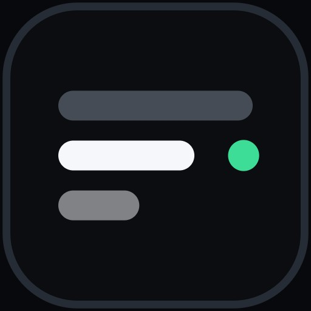
</p>

<h1 align="center">String Theory</h1>

<p align="center">Pixel-aware rewriting for interface copy, with a human decision on every string.</p>

<p align="center">
  
  
  
  
  
  
</p>

<p align="center">
  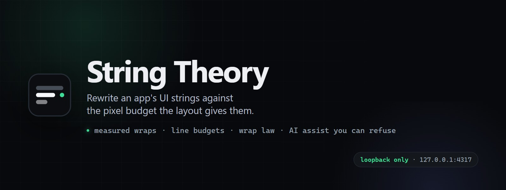
</p>

String Theory is a local tool for rewriting an application's interface strings against the width the layout actually gives them. The app exports its strings with an id, the screen each one appears on, and the pixel budget for that line. String Theory shows the source on the left and your rewrite on the right, wraps both the way the layout will, and marks every string as untouched, in progress, or finished. The replacements export in the same shape they arrived in.

It runs on your machine, listens on `127.0.0.1`, keeps working sets in the browser, and uploads nothing except the AI calls you ask for.

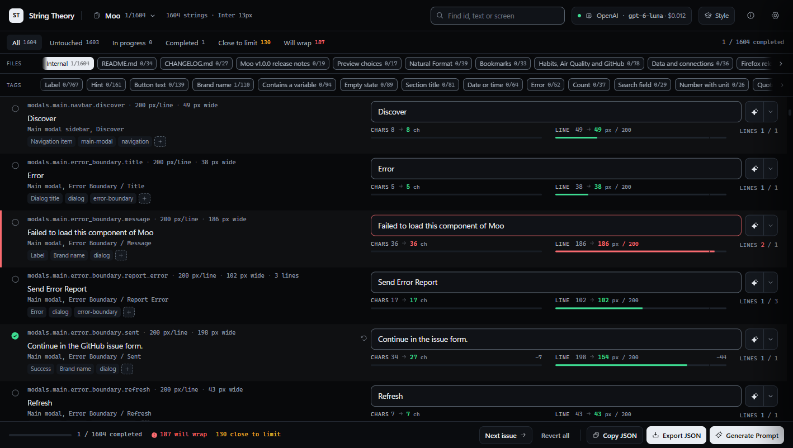

## The problem it solves

A string that reads well can still be wrong. "Session Transcripts" fits a 150 pixel header; "Session transcripts for this run" wraps onto a second line the layout never allowed, and the defect shows up on a player's screen at 1440 by 900, not in the file. Character counts do not catch it either, because one wide word costs more than two narrow ones.

So the budget has to be measured, not estimated, and it has to be measured in the font the app renders with. That is the whole tool: a real canvas measurement of every string you touch, against the box the app gives it, with the verdict in front of you while you type.

## What it measures

Every string carries a line budget and a line allowance. The tool wraps the text greedily at spaces inside `maxPxPerLine` in the declared font, which produces three numbers that decide the verdict:

- **Lines against the allowance.** Two lines of text in a one-line label is a spill, however short the widest line is.
- **The widest line against the box.** A single word wider than the box cannot fit with or without wrapping.
- **The last line, against the box.** This is the wrap law from interface copywriting practice: if a string wraps, its last line must fill at least 40% of the box and carry more than one word. A last line holding one stranded word is an orphan, and the row goes amber with the percentage it fills (`orphan 23%`). The fix is rebalancing the words, never shrinking the type or hyphenating.

Verdicts are a left border and a tint: green fits, amber fits but reads badly at the break or sits within 10% of the box, red spills. The characters meter is there for the apps that enforce their own character cap, and it stays out of the pixel verdict.

Fonts are measured as declared: family, size, weight and letter spacing, per file, with an optional per-string override for the panel title that is 16px inside a file of 14px labels.

## One applied provider and model

A pass runs with exactly one provider and one model, and Settings says which: every provider carries a checkbox, ticking one applies it, and the tick moves — checking a second provider unchecks the first. The applied pair names itself twice: on the provider row, where the subtitle becomes the model, and in the header chip (`OpenAI · gpt-5.6-luna · $0.008`), which is what the Polish button on any row will use. Switching away keeps each provider's last model, so returning to it restores your pick rather than resetting to whatever sits first in the catalogue.

## Model catalogues

A hardcoded model list is wrong the week it ships. Every provider publishes its own catalogue, so the app asks for it, caches the answer and asks again when the answer is stale:

- **Fetched on demand and on change.** Saving a key, finishing a sign-in, or pointing a provider at another endpoint each pulls a fresh catalogue. A stale one (24 hours by default, adjustable in Settings) is re-fetched in the background the next time the app loads, so the picker rarely shows anything old.
- **Cached on disk.** `data/models-cache.json` holds what each provider returned, when, and whether the last check passed. Cached lists survive restarts; the curated arrays in the server are only a seed for a provider that has never answered.
- **The listing is the health check.** `GET /models` answers 200 only to a credential the provider accepts, so a successful fetch proves the key works. A failure is kept apart by cause: a 401 is a rejected credential, a 502 means the provider could not be reached, and a key that may chat but not read the catalogue — an OpenAI project key without `api.model.read`, for instance — is reported as limited instead of dead, with the curated list shown.
- **Nothing is lost by a bad check.** A temporary failure keeps the last good catalogue; only a rejected credential clears it.

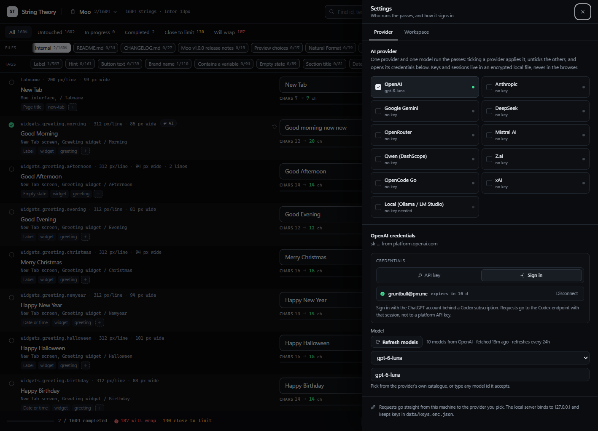

## Documents, beside the app

An app's own strings are half of what a project says. The other half is prose: the README, the changelog, the release notes and the guides those link to. Nobody measures a paragraph, so that is where the worst writing survives longest.

A project folder can hold both. Load any file in `inbox/<project>/` and every export beside it opens too, then a row of file names appears under the status filters:

```
Files   Internal 0/4   README.md 0/7   CHANGELOG.md 0/3   guide.md 0/2
```

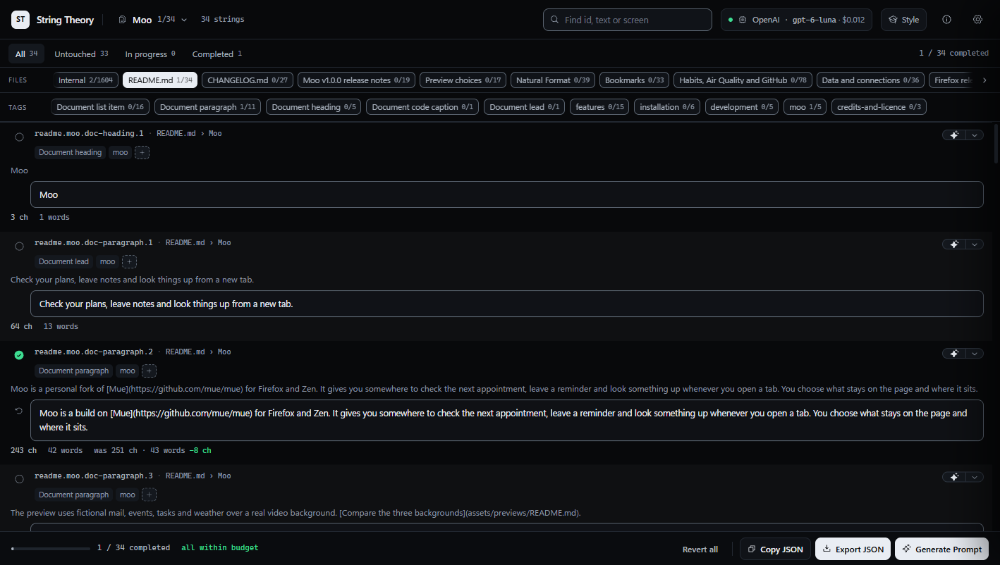

Internal is the app's strings. The rest are documents, ordered the way a reader meets them: the README first, then the changelog, then the release notes, then whatever the README links to, in link order. Each pill carries its own progress, and clicking one switches the list — the filters, the search and the tags stay put.

A docs file declares `surface: "docs"` and carries no font, no wrap box and no budgets, because a document has no layout. Those rows get a tall paragraph box, the source paragraph above it for comparison, and character, word and length counts instead of fit meters; `Close to limit` and `Will wrap` are not shown on a lane that cannot wrap. Everything else works the same: tags, states, passes, the change prompt, and an export that writes the same shape back.

The AI instructions in the app ask for both kinds of file: the app export, then one file per document with its order, so an agent that owns a repository can hand back a whole project at once.

## Large files

A real app has thousands of strings, and rendering all of them is what makes a tool feel broken: every row carries a measured canvas, a textarea, three meters and its tags. The list is windowed instead. Only the rows around the viewport are mounted, each absolutely positioned inside a spacer as tall as the whole file, so the scrollbar stays honest and a jump to row 900 still lands.

Measured on the 1,604-string Moo export in this repository: opening the file went from **3,139 ms to 149 ms**, the document from **105,671 elements to 1,099**, and the mounted rows from 1,604 to 13. Row heights are measured, never assumed — a row grows when the text wraps or a tag is added, and every row below it moves by exactly that much. The row being edited stays mounted while it scrolls out of view, so focus is never stolen mid-sentence.

## Changes, written as instructions

Not every app can read a JSON file back, and waiting on a converter is a good way to never see a rewrite land. `Generate Prompt`, at the end of the footer, writes the changed strings as instructions instead: one line per change, ready to paste into whatever agent owns the app.

```
Apply 2 string changes in Session Transcripts.

## Transcripts
- Replace "Start recording" with "Start capture" in Button text (id: transcripts.record.start)
- Replace "Session Transcripts" with "Transcripts" in Heading (id: transcripts.panel.title)
```

Each line names the text as it is now, the text it must become, and the section the tags describe. The rules above the list say to match exactly, to touch nothing else, to keep placeholders and shortcuts byte for byte, and to report a line it could not find rather than guess at one. The list closes by asking for a count of what was applied.

The grouping comes from the tags: the heading is the part of the app (`Transcripts`, `Settings`, `Upload`) and the line names the role inside it (`Button text`, `Hint`, `Error`). A row emptied and marked complete is a removal, and the list says so:

```
Remove "Rewrites stay on this machine." in Hint (id: app.hint)
```

"Replace this with nothing" reads to a model like a mistake, and it tends to produce an empty label where the code needed the whole line gone. The rules above the list spell the difference out: delete the line, the key and its entry, and any separator that only existed to glue it to its neighbour, without renumbering anything around it. An emptied row that is still in progress is a draft, not an instruction, so it is left out of the list and counted on the header instead. The row itself wears a small `removes` tag, so the intent is visible while you work.

Two switches change the shape — grouping can be off, and ids can be left out unless a source text appears twice with different rewrites, in which case the id stays because it is the only thing that separates the lines. Quotes and line breaks inside a string are escaped the way JSON escapes them, so a line stays one line.

`Copy prompt` takes the whole thing; `Copy lines only` takes just the change list for an agent that already knows the job. Nothing about this needs a metadata file, an exporter change, or an app that speaks the format.

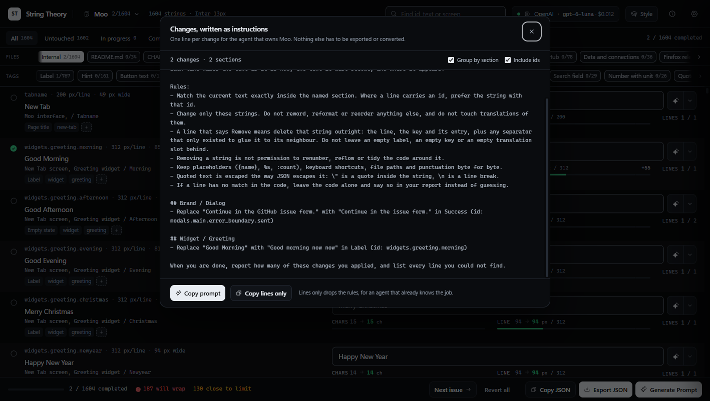

## The round trip

```
app catalogue ──export──▶ app.strings.json ──▶ String Theory ──▶ app.rewritten.json ──▶ app catalogue
                                │                                        │
                  ids, text, where, maxPxPerLine,                text, previous, state,
                  maxLines, font, maxChars                       changed, by id
```

The format is the product. [`docs/format.md`](docs/format.md) is canonical, [`docs/string-theory.schema.json`](docs/string-theory.schema.json) is the machine version, and the same reference is available inside the app from the info button. Any export can be checked before it is handed over:

```powershell
node scripts/validate-export.mjs path/to/app.strings.json
```

Rewrites merge back by `id`, never by position or by matching text. `previous` is always written so a merge can detect that the source changed underneath it.

## Working through a file

The glyph at the left of each row is the whole workflow. Click it to move a string from untouched to completed, and to rotate between completed and in progress. Right-click returns it to untouched without touching the text. Typing a change marks the string completed, because a rewrite that differs from the source is a decision you made.

Filters count by state (`Untouched`, `In progress`, `Completed`) and by fit (`Close to limit`, `Will wrap`), and `Next issue` walks the spills. A rail of file names sits above the tags — `Internal` for the app's own strings, then the project's documents in reading order, each with its own progress — and clicking one switches the list without losing an edit. A project with more files than fit scrolls: the wheel works, and a caret pair appears at whichever end still has something behind it. Several projects stay open at once, each with its own working set. The inbox in this repository holds one, Moo, which is the project every screenshot on this page uses.

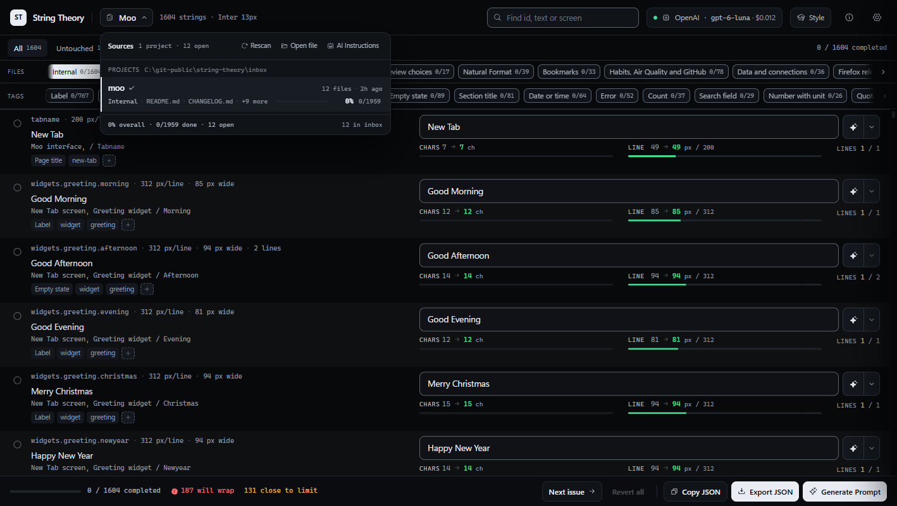

A second rail groups the strings by what they do. Every string carries one or more tags — `heading`, `hint`, `button`, `error`, `table-header`, and so on — plus any grouping tag the app invents, such as `settings` or `checkout`. Each tag shows its own progress (`3/12 done`), and clicking one narrows the list to those strings, so a pass over only the hints, or only one screen, is a click instead of a search. Several tags at once can mean any or all of them.

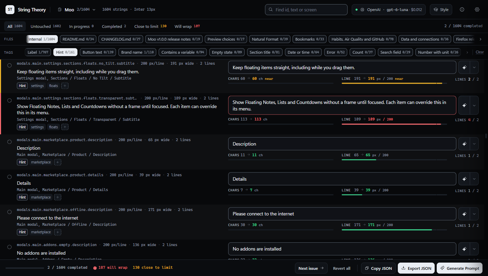

## AI assist you can refuse

Every AI action is per string and per click. There is no "polish all", because an unreviewed batch defeats the point of rewriting copy in your own words.

- **Passes.** The control beside the input runs a Grammar, Style or Fit pass on that one string. The prompt carries the string, its screen, the measured width, the line budget and the wrap law, and the answer is measured again like any manual edit.
- **Voices.** The menu is two columns: the passes on the left, and on the right the voices — five editorial methods, Humanizer, Product strings, Short pass, Simple English and Prose, each a different way of rewriting the same string and all of them subtraction-only. Every voice gets the same budget and placeholder rules as the passes, so a humanized string still has to fit its box. A prose voice is offered on documents and a product voice on app strings, so the list suits the lane you are in.
- **Your profile.** The switch at the foot of the voice column applies a writing profile to whichever method you pick, and it is on until you turn it off. The profile is read from a file on this machine at request time — `C:/git/self-profile/profile/operational.md` by default, settable in Settings → Workspace, where you also name it — and its text is never copied into this project or sent anywhere except inside the prompt you asked for. If the file is missing the switch says so and the pass runs without it. This tool carries its own copy of the humanizer family, separate from the one Hermes runs, which is why the parts are named for it: `user-profile`, not a named person's profile.
- **What the menu offers.** Settings → Workspace has two switches: list every voice in the pass menu, and show your profile in it. Turn both off and the menu is the three passes again.
- **Style analyst.** After you have marked rewrites completed, the analyst compares each shipped string with your version and writes down the differences as rules: voice, sentence shape, word swaps, length discipline, punctuation, and what you never write. It needs three pairs, samples evenly across a large file, and saves a markdown profile per app. The file is shaped as a skill reference, so pointing the style folder at a writing skill's `references/` directory lets a writing agent load your house style with the skill.

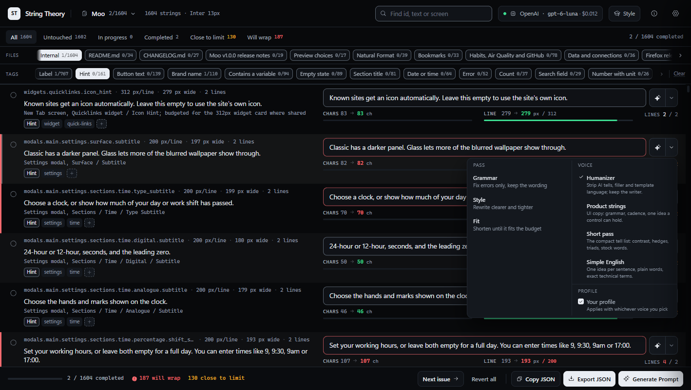

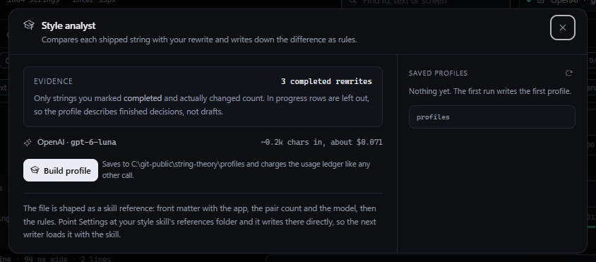

Providers are the usual set: OpenAI, Anthropic, Google Gemini, DeepSeek, OpenRouter, Mistral, Qwen, Z.ai, OpenCode Go, xAI, and a local OpenAI-compatible server for Ollama or LM Studio. Where a provider runs a real OAuth flow you can sign in instead of pasting a key. Three are wired: xAI and ChatGPT by device code, and Claude by approving in the browser and pasting the code it shows. Each keeps a sealed session on this machine, refreshes itself before it expires, and falls back to a key the moment you pin one. A ChatGPT session is only accepted by the Codex endpoint, so those calls go there, not to `api.openai.com`. Every call is written to a usage ledger with token counts and an estimated cost, and daily and monthly budgets stop the calls when they are reached.

## Screenshots

| The wrap, measured | One file, several sources |
| --- | --- |
| 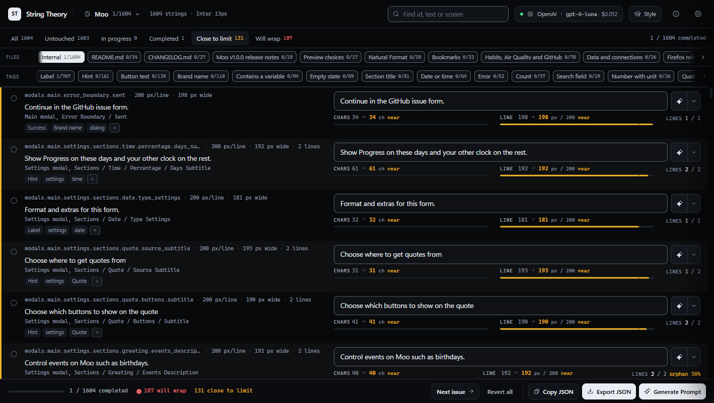 | 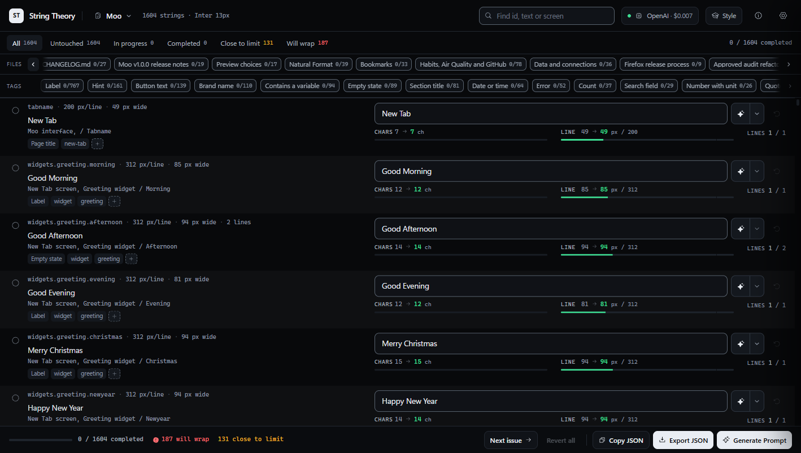 |

## Accessibility

The list is the product, so it is built to be read rather than looked at:

- Every verdict pairs its colour with a number and a word: `+32 over`, `137 / 150`, `orphan 23%`. Nothing is communicated by hue alone.
- Meters are progress bars with a spoken value, and each row carries a screen-reader sentence with its budget, the lines it needs and whether the last line is stranded.
- `Tab` reaches the source state glyph, the input, the pass control and the revert button in reading order. The row being edited lights its edge through `:focus-within`.
- Dialogs trap focus, close on `Escape` and hand focus back to the control that opened them. A closed settings drawer is `inert`, so it never catches a stray tab.
- Reduced motion removes the entrance animations, the meter easing and the shimmer, and keeps the state changes instant.
- Contrast is computed, not eyeballed: `npm run check:contrast` checks 21 text and border pairs against WCAG 2.1 AA, and the build is expected to keep all of them passing.

## Quick start

Node 22 or newer.

```powershell
npm install
npm run build
npm run dev
```

One URL in both modes, <http://127.0.0.1:4317>. In dev the supervisor starts Vite on 4317 with hot module replacement and the API on 4318 behind the `/api` proxy, so a client edit lands in the open page and a server edit restarts the API without touching your working sets.

### Keep it running

```powershell
powershell -ExecutionPolicy Bypass -File scripts\install-startup.ps1
```

That registers a hidden logon task with restart-on-failure and puts a **String Theory** shortcut on the desktop. The shortcut starts the server when it is down and opens the browser; when it is already up it only opens the browser. No console window appears. Undo it with `-Remove`.

| Command | What it does |
| --- | --- |
| `npm run serve:status` | mode, URL, pid and health of the running server |
| `npm run serve:restart` | stop, start detached, wait for health, return |
| `npm run serve:stop` | stop the supervisor and its children |
| `node scripts/serve.mjs open` | start if needed, then open the browser |

Logs go to `data/server.log`, rotated at 5 MB. A crashed child is restarted with backoff, and the task restarts the supervisor.

### Switch to prod

```powershell
npm run build
node scripts/serve.mjs mode prod
npm run serve:restart
```

Prod serves `dist/` and the API from one process on 4317, with no Vite and no hot reload. Going back is `mode dev` and a restart. The mode lives in `serve.config.json`, so the hidden launcher and the logon task follow it without being edited.

## Handing the work to an agent

The source picker carries the instructions you would otherwise write by hand. Open it, choose AI Instructions, and paste the result into whatever agent owns the other project: it names the folder to write into, the `string-theory/1` fields that make a file judgeable, the wrap law, and the validator command to run before handing it back. The same text opens from the empty state of the inbox, so the first export needs no prior conversation.

## Where things live

| Path | What it holds |
| --- | --- |
| `data/` | Runtime state: config, the sealed key vault, the OAuth session store, the usage ledger, the log. Gitignored, delete it to reset. |
| `profiles/` | Style profiles written by the analyst, one markdown file per app. |
| `inbox/` | Exports you work on. Input only: the tool never writes there, and a rewrite leaves as a download. Drop one file per app under `inbox/<project>/` and the project appears in the source picker without a restart; every file in that folder opens with it. |
| `samples/demo.strings.json` | The sample the empty state loads, with one row in each verdict. |

Keys are encrypted with AES-256-GCM under `data/master.key` and never returned to the browser; OAuth sessions are sealed the same way, with only the expiry and the account label readable. The local server has no authentication because it only listens on loopback. Do not expose port 4317 to a network.

## Development

```powershell
npm run build                        # tsc --noEmit && vite build
npm run check:contrast               # WCAG ratios for every token pair
npm run smoke                        # 31 end-to-end checks; needs the server up
node scripts/validate-export.mjs samples/demo.strings.json
```

There is no test framework. `scripts/smoke.mjs` starts a stub OpenAI-compatible provider and runs real calls through the server: prompt contents, token and cost accounting, the budget guard, the credential errors, the analyst's three-pair floor, and the profile listing. Then it restores the config it changed.

`scripts/oauth-flow.mjs` points the token endpoints at a local stub and checks the three sign-in shapes without borrowing an account: the PKCE parameters on the Claude authorize URL, the code exchange, the Codex device handshake, refresh rotation, a spent flow being refused, and the headers each authentication style puts on the wire.

The architecture, the invariants that must not drift, and the map of which file owns which job are in [`AGENTS.md`](AGENTS.md). The banner and the icon are regenerated from `brand/` at fixed sizes, and every screenshot is shot on the Moo project at 1,418 px wide.

## Changelog

[CHANGELOG.md](CHANGELOG.md) lists what each public release added. 1.0.0 is the
first.

## License

MIT. See [LICENSE](LICENSE).
