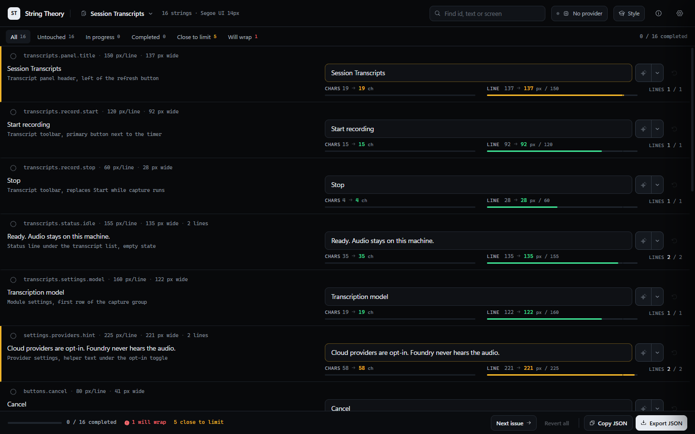
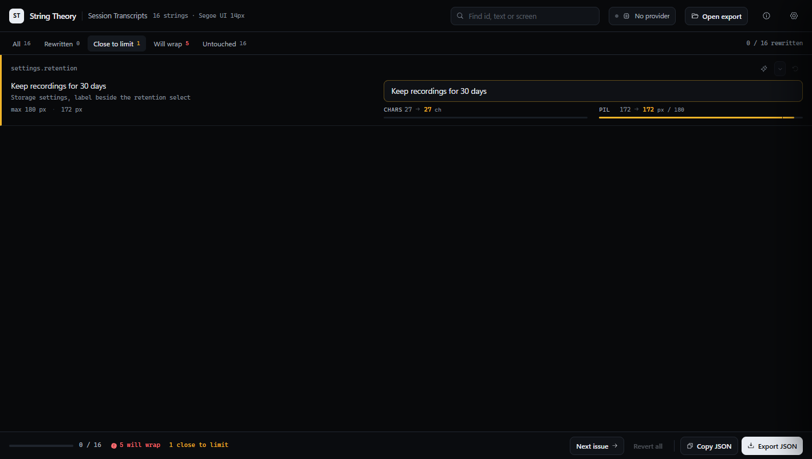

# String Theory

An internal tool for rewriting an application's own UI strings. An app exports its strings with an id, the line of UI where each one appears, and the pixel width that line must not exceed. String Theory shows the source on the left and a prefilled input on the right, counts characters and measured pixels as you type, and exports the replacements in the same shape.

It is built for one operator on one machine, not for a team or a public site. The local server binds to `127.0.0.1`; nothing is uploaded except the AI polish requests you trigger yourself.



## Run it

Node 22 or newer.

```powershell
npm install
npm run build
npm run dev
```

One URL in both modes, <http://127.0.0.1:4317>. In dev the supervisor starts Vite on 4317 with hot module replacement and the API on 4318 behind the `/api` proxy, so a client edit lands in the open page and a `server/` edit restarts the API, without touching your working sets.

### Keep it running

```powershell
powershell -ExecutionPolicy Bypass -File scripts\install-startup.ps1
```

That registers a hidden logon task with restart-on-failure and puts a **String Theory** shortcut on the desktop. The shortcut starts the server when it is down and opens the browser; when the server is already up it only opens the browser. Nothing appears in the taskbar and no console window opens. Undo it with `-Remove`.

| Command | What it does |
| --- | --- |
| `npm run serve:status` | mode, URL, pid and health of the running server |
| `npm run serve:restart` | stop, start detached, wait for health, return |
| `npm run serve:stop` | stop the supervisor and its children |
| `node scripts/serve.mjs open` | start if needed, then open the browser |

Logs go to `data/server.log`, rotated at 5 MB. A crashed child is restarted with backoff, and the supervisor itself is restarted by the task.

### Switch to prod

```powershell
npm run build
node scripts/serve.mjs mode prod
npm run serve:restart
```

Prod serves `dist/` and the API from one process on 4317, with no Vite and no hot reload. Going back is `mode dev` and a restart. The mode lives in `serve.config.json`, so the hidden launcher and the logon task follow it without being edited.

## Use it

1. Open the **Sources** picker next to the wordmark. It lists every export in the inbox folder, plus anything opened from disk. Pick one; the sample is available from the empty state if the inbox is empty.
2. Read the source on the left. Hovering it shows the full location line, the pixel budget and the font the measurement uses.
3. Type the rewrite on the right. The **chars** and **PIL** counters under the input compare the source value with the current one:
   - green, comfortably inside the budget
   - amber, past the threshold (90% by default), close enough that a translation or a bigger UI scale will spill
   - red, measured past `maxPx`, so the line will wrap where the app expected one line
   The PIL meter prints how many pixels over the limit you are when it goes red.

   
4. **Polish** sends one string to the connected AI provider for a grammar and style pass. The caret beside it runs Grammar, Style or Fit instead of the default pass. `Ctrl+Enter` inside an input does the same, `Esc` reverts that row.
5. **Export JSON** downloads `<app>.rewritten.json` with the current text, the previous text and a `changed` flag per string. **Copy JSON** puts the same payload on the clipboard.

Filters, search, `Next issue` and the status bar exist to get you to the two strings that will wrap, not to browse.

## Several projects at once

The picker next to the wordmark is the source list. Every `.json` export in `inbox/` appears there with its app name, string count, import notes and how far you have got with it.

```
inbox/
  session-transcripts.strings.json
  hermes-todo/hermes-todo.strings.json
  casino-simulator.strings.json
```

Other projects and agents drop files there; **Rescan** picks up new ones without a restart. Subfolders group related files, up to three levels deep, and each row shows the folder it came from.


Three exports in the inbox. Two have working sets, so they carry a bar and a percentage; the third shows `not open` and its size. The footer totals every open file.

Switching sources keeps each working set: rows, edits and progress are stored per file in the browser, so a project parked at 40% is still at 40% after you work on something else or reload. The picker shows `19% 3/16` for a file with three rewrites, and the footer totals every open file.

Files opened with **Open file** or dropped on the window join the list too, under their own heading. A working set whose file has since been deleted stays visible as "gone from the inbox", because the rewrites are still yours until you discard them.

Progress is computed from the rewrites in that file: a row counts when its text differs from the source. Nothing is written back to the inbox; the export is a separate download.


## Export format

The full field reference, accepted aliases and the merge rule are in [docs/format.md](docs/format.md). The short version:

```json
{
  "format": "string-theory/1",
  "app": "Session Transcripts",
  "font": { "family": "Segoe UI", "size": 14, "weight": 400 },
  "defaultMaxPx": 200,
  "strings": [
    {
      "id": "panel.title",
      "text": "Session Transcripts",
      "where": "Panel header, left of the refresh button",
      "maxPx": 180,
      "maxChars": 24
    }
  ]
}
```

`font` is not decoration. The pixel figures come from measuring each string in that font with a canvas, so the export has to declare what the app really renders with. If the family is not installed on this machine the browser substitutes one, and the settings panel says so.

The contract, the aliases a rough exporter can get away with, the validity rules and the merge algorithm are in [docs/format.md](docs/format.md). The machine-readable version is [docs/string-theory.schema.json](docs/string-theory.schema.json), and any file can be checked before it is handed over:

```powershell
node scripts/validate-export.mjs path/to/app.strings.json
```

Errors block an export; warnings still load and show up in a dismissible strip above the list, along with anything the import had to repair. The same reference is available inside the app from the **info** button in the header.

## AI providers

The provider set matches the one Lingarr Next exposes for AI work: OpenAI, Anthropic, Google Gemini, DeepSeek, OpenRouter, Mistral, Qwen (DashScope), Z.ai, OpenCode Go, xAI, and a local OpenAI-compatible server for Ollama or LM Studio. Pick one in Settings, paste the key, fetch the model list (or type a model id), and it becomes the polish engine.

- Keys are written to `data/keys.enc.json`, encrypted with AES-256-GCM under `data/master.key`. The browser never receives them; requests are proxied by the local server.
- Each provider keeps its own endpoint override, so a gateway or proxy works without code changes.
- xAI is API key only. The OAuth session Lingarr Next holds is its own and is not reusable here.

Every call is logged to `data/usage.json` with token counts and an estimated cost. The pricing table covers OpenAI, Anthropic, DeepSeek and `openrouter/free`; other providers record tokens but no cost, and the settings panel warns when today's calls cannot be priced. Daily and monthly USD budgets stop the polish calls when they are reached.

The prompt sends the string, its id, the location line, the measured width and a character budget derived from `maxPx`. Placeholders, shortcuts and product names are copied byte for byte, and the answer is trimmed of fences and stray quotes before it lands in the input. A rewrite is never trusted to fit: it is measured again, and goes red like any manual edit.

## Data and privacy

Everything lives under `data/` and is gitignored: `config.json`, `keys.enc.json`, `master.key`, `usage.json`, `server.log`. Delete the folder to reset. Working sets live in the browser's local storage under `string-theory.library.v2`, one record per source.

`inbox/` holds the exports you work on. It is gitignored apart from its README, and the tool never writes to it: the rewritten file is a download, not an edit in place.

The server has no authentication because it only listens on loopback. Do not expose port 4317 to a network.

## Scripts

| Command | What it does |
| --- | --- |
| `npm run dev` | Supervisor in dev mode: Vite with hot reload on 4317, API on 4318 |
| `npm run build` | Typecheck and build the client into `dist/` |
| `npm run serve` | Supervisor in the mode from `serve.config.json` |
| `npm start` | API server alone on 4317, serving `dist/`. No supervisor, no auto-restart |
| `node scripts/smoke.mjs` | End-to-end check against a running server: provider round trip, prompt contents, usage accounting, budget guard, credential errors |
| `node scripts/validate-export.mjs <file>` | Check an export against the format contract. `--strict` fails on warnings too |

## Known limits

- One locale per file. There is no multi-language string table; a second locale is a second export.
- The app is a single-operator tool on loopback. There is no auth, no sharing and no remote access.
- Pixel numbers depend on the declared font being installed and on canvas measuring text the way the app lays it out. Letter spacing and weight are honoured; kerning-only differences and platform font hinting are not.
- The AI is per string, deliberately. There is no "polish all" because an unreviewed batch defeats the point of rewriting in your own words.
- Cost estimates are a local price table, not provider billing. Treat them as a guardrail, not an invoice.
