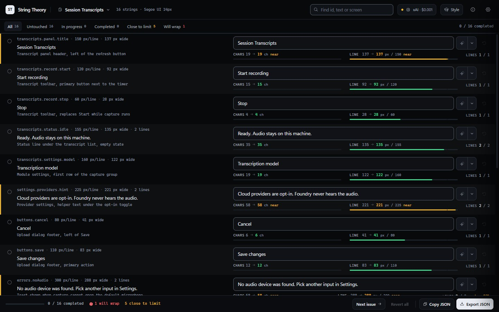
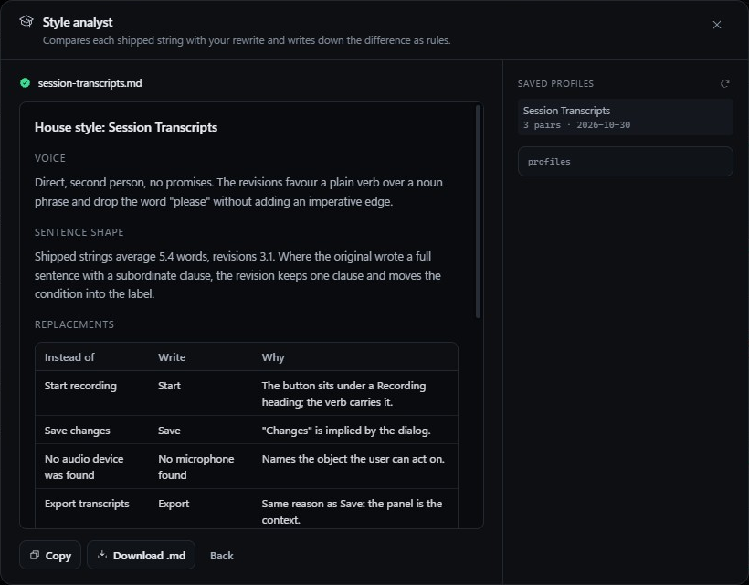
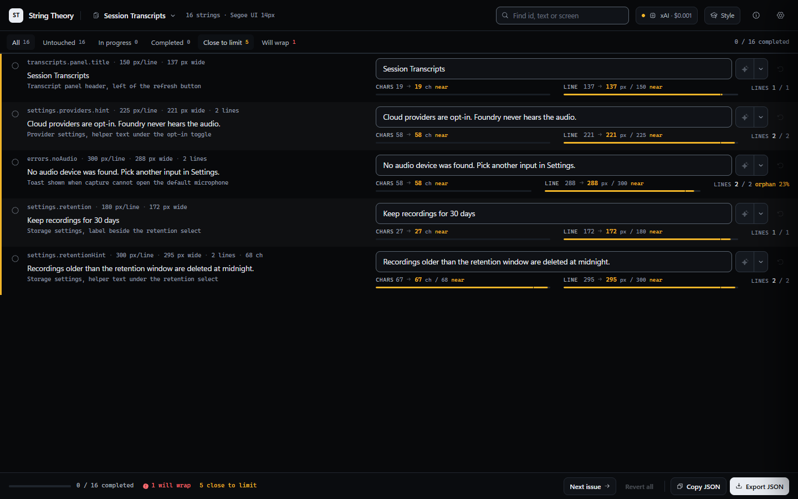
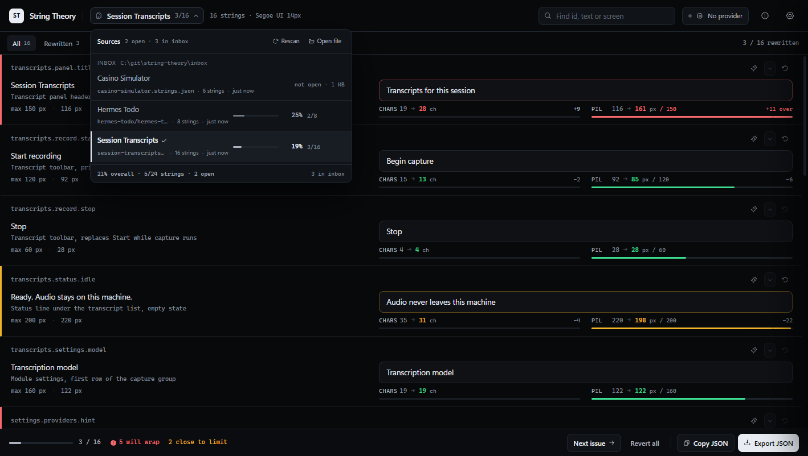

<p align="center">
  
</p>

<h1 align="center">String Theory</h1>

<p align="center">Pixel-aware rewriting for interface copy, with a human decision on every string.</p>

<p align="center">
  
  
  
  
  
  
</p>

<p align="center">
  
</p>

String Theory is a local tool for rewriting an application's interface strings against the width the layout actually gives them. The app exports its strings with an id, the screen each one appears on, and the pixel budget for that line. String Theory shows the source on the left and your rewrite on the right, wraps both the way the layout will, and marks every string as untouched, in progress, or finished. The replacements export in the same shape they arrived in.

It runs on your machine, listens on `127.0.0.1`, keeps working sets in the browser, and uploads nothing except the AI calls you ask for.



## The problem it solves

A string that reads well can still be wrong. "Session Transcripts" fits a 150 pixel header; "Session transcripts for this run" wraps onto a second line the layout never allowed, and the defect shows up on a player's screen at 1440 by 900, not in the file. Character counts do not catch it either, because one wide word costs more than two narrow ones.

So the budget has to be measured, not estimated, and it has to be measured in the font the app renders with. That is the whole tool: a real canvas measurement of every string you touch, against the box the app gives it, with the verdict in front of you while you type.

## What it measures

Every string carries a line budget and a line allowance. The tool wraps the text greedily at spaces inside `maxPxPerLine` in the declared font, which produces three numbers that decide the verdict:

- **Lines against the allowance.** Two lines of text in a one-line label is a spill, however short the widest line is.
- **The widest line against the box.** A single word wider than the box cannot fit with or without wrapping.
- **The last line, against the box.** This is the wrap law from interface copywriting practice: if a string wraps, its last line must fill at least 40% of the box and carry more than one word. A last line holding one stranded word is an orphan, and the row goes amber with the percentage it fills (`orphan 23%`). The fix is rebalancing the words, never shrinking the type or hyphenating.

Verdicts are a left border and a tint: green fits, amber fits but reads badly at the break or sits within 10% of the box, red spills. The characters meter is there for the apps that enforce their own character cap, and it stays out of the pixel verdict.

Fonts are measured as declared: family, size, weight and letter spacing, per file, with an optional per-string override for the panel title that is 16px inside a file of 14px labels.

## The round trip

```
app catalogue ──export──▶ app.strings.json ──▶ String Theory ──▶ app.rewritten.json ──▶ app catalogue
                                │                                        │
                  ids, text, where, maxPxPerLine,                text, previous, state,
                  maxLines, font, maxChars                       changed, by id
```

The format is the product. [`docs/format.md`](docs/format.md) is canonical, [`docs/string-theory.schema.json`](docs/string-theory.schema.json) is the machine version, and the same reference is available inside the app from the info button. Any export can be checked before it is handed over:

```powershell
node scripts/validate-export.mjs path/to/app.strings.json
```

Rewrites merge back by `id`, never by position or by matching text. `previous` is always written so a merge can detect that the source changed underneath it.

## Working through a file

The glyph at the left of each row is the whole workflow. Click it to move a string from untouched to completed, and to rotate between completed and in progress. Right-click returns it to untouched without touching the text. Typing a change marks the string completed, because a rewrite that differs from the source is a decision you made.

Filters count by state (`Untouched`, `In progress`, `Completed`) and by fit (`Close to limit`, `Will wrap`), `Next issue` walks the spills, and the source picker shows the percentage finished per file, so a project parked halfway is visible before you open it. Several files stay open at once, each with its own working set, and switching between them never drops an edit.

## AI assist you can refuse

Every AI action is per string and per click. There is no "polish all", because an unreviewed batch defeats the point of rewriting copy in your own words.

- **Passes.** The control beside the input runs a Grammar, Style or Fit pass on that one string. The prompt carries the string, its screen, the measured width, the line budget and the wrap law, and the answer is measured again like any manual edit.
- **Style analyst.** After you have marked rewrites completed, the analyst compares each shipped string with your version and writes down the differences as rules: voice, sentence shape, word swaps, length discipline, punctuation, and what you never write. It needs three pairs, samples evenly across a large file, and saves a markdown profile per app. The file is shaped as a skill reference, so pointing the style folder at a writing skill's `references/` directory lets a writing agent load your house style with the skill.



Providers are the usual set: OpenAI, Anthropic, Google Gemini, DeepSeek, OpenRouter, Mistral, Qwen, Z.ai, OpenCode Go, xAI, and a local OpenAI-compatible server for Ollama or LM Studio. Where a provider runs a real OAuth flow you can sign in instead of pasting a key. Three are wired: xAI and ChatGPT by device code, and Claude by approving in the browser and pasting the code it shows. Each keeps a sealed session on this machine, refreshes itself before it expires, and falls back to a key the moment you pin one. A ChatGPT session is only accepted by the Codex endpoint, so those calls go there, not to `api.openai.com`. Every call is written to a usage ledger with token counts and an estimated cost, and daily and monthly budgets stop the calls when they are reached.

## Screenshots

| The wrap, measured | One file, several sources |
| --- | --- |
|  |  |

## Accessibility

The list is the product, so it is built to be read rather than looked at:

- Every verdict pairs its colour with a number and a word: `+32 over`, `137 / 150`, `orphan 23%`. Nothing is communicated by hue alone.
- Meters are progress bars with a spoken value, and each row carries a screen-reader sentence with its budget, the lines it needs and whether the last line is stranded.
- `Tab` reaches the source state glyph, the input, the pass control and the revert button in reading order. The row being edited lights its edge through `:focus-within`.
- Dialogs trap focus, close on `Escape` and hand focus back to the control that opened them. A closed settings drawer is `inert`, so it never catches a stray tab.
- Reduced motion removes the entrance animations, the meter easing and the shimmer, and keeps the state changes instant.
- Contrast is computed, not eyeballed: `npm run check:contrast` checks 17 text and border pairs against WCAG 2.1 AA, and the build is expected to keep all of them passing.

## Quick start

Node 22 or newer.

```powershell
npm install
npm run build
npm run dev
```

One URL in both modes, <http://127.0.0.1:4317>. In dev the supervisor starts Vite on 4317 with hot module replacement and the API on 4318 behind the `/api` proxy, so a client edit lands in the open page and a server edit restarts the API without touching your working sets.

### Keep it running

```powershell
powershell -ExecutionPolicy Bypass -File scripts\install-startup.ps1
```

That registers a hidden logon task with restart-on-failure and puts a **String Theory** shortcut on the desktop. The shortcut starts the server when it is down and opens the browser; when it is already up it only opens the browser. No console window appears. Undo it with `-Remove`.

| Command | What it does |
| --- | --- |
| `npm run serve:status` | mode, URL, pid and health of the running server |
| `npm run serve:restart` | stop, start detached, wait for health, return |
| `npm run serve:stop` | stop the supervisor and its children |
| `node scripts/serve.mjs open` | start if needed, then open the browser |

Logs go to `data/server.log`, rotated at 5 MB. A crashed child is restarted with backoff, and the task restarts the supervisor.

### Switch to prod

```powershell
npm run build
node scripts/serve.mjs mode prod
npm run serve:restart
```

Prod serves `dist/` and the API from one process on 4317, with no Vite and no hot reload. Going back is `mode dev` and a restart. The mode lives in `serve.config.json`, so the hidden launcher and the logon task follow it without being edited.

## Where things live

| Path | What it holds |
| --- | --- |
| `data/` | Runtime state: config, the sealed key vault, the OAuth session store, the usage ledger, the log. Gitignored, delete it to reset. |
| `profiles/` | Style profiles written by the analyst, one markdown file per app. |
| `inbox/` | Exports you work on. Input only: the tool never writes there, and a rewrite leaves as a download. |
| `samples/demo.strings.json` | The sample the empty state loads, with one row in each verdict. |

Keys are encrypted with AES-256-GCM under `data/master.key` and never returned to the browser; OAuth sessions are sealed the same way, with only the expiry and the account label readable. The local server has no authentication because it only listens on loopback. Do not expose port 4317 to a network.

## Development

```powershell
npm run build                        # tsc --noEmit && vite build
npm run check:contrast               # WCAG ratios for every token pair
npm run smoke                        # 19 end-to-end checks; needs the server up
node scripts/validate-export.mjs samples/demo.strings.json
```

There is no test framework. `scripts/smoke.mjs` starts a stub OpenAI-compatible provider and runs real calls through the server: prompt contents, token and cost accounting, the budget guard, the credential errors, the analyst's three-pair floor, and the profile listing. Then it restores the config it changed.

`scripts/oauth-flow.mjs` points the token endpoints at a local stub and checks the three sign-in shapes without borrowing an account: the PKCE parameters on the Claude authorize URL, the code exchange, the Codex device handshake, refresh rotation, a spent flow being refused, and the headers each authentication style puts on the wire.

The architecture, the invariants that must not drift, and the map of which file owns which job are in [`AGENTS.md`](AGENTS.md). The screenshots and the banner are regenerated from `brand/` at fixed sizes.

## License

MIT. See [LICENSE](LICENSE).
